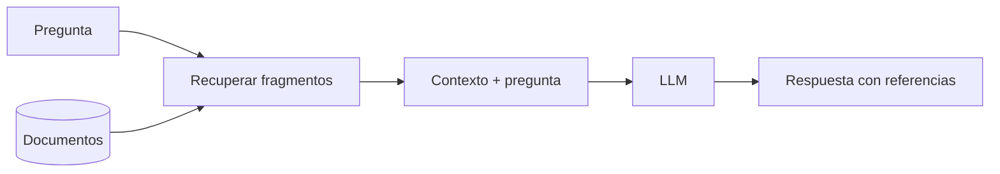
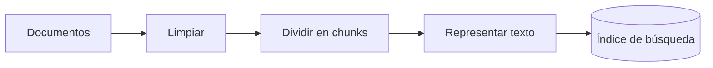
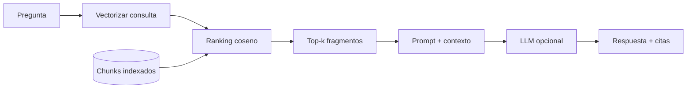
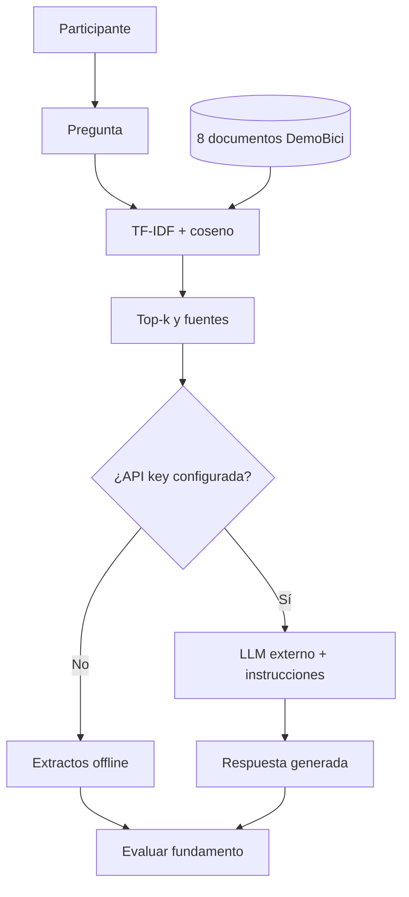
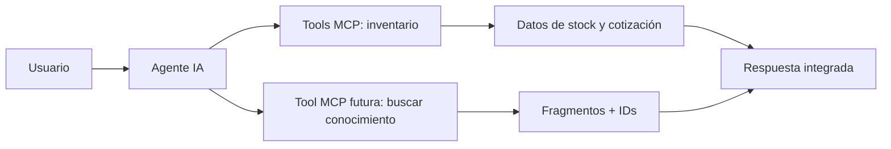

<!-- .slide: class="cover" -->

<div class="cover-card">
  <p class="cover-kicker" data-config="eyebrow">TALLER PRÁCTICO · IA GENERATIVA</p>
  <h1 class="cover-title" data-config="title">Tu primer sistema RAG</h1>
  <p class="cover-description" data-config="subtitle">De documentos a respuestas con evidencia: aprende, experimenta y construye.</p>
  <div class="cover-separator"></div>
  <p class="cover-author" data-config="name">Jorge Jesús Quispe Villaverde</p>
  <p class="cover-role" data-config="role">AI Engineer · Applied AI Researcher · AI Mentor</p>
  <div class="contact-row"><a class="contact-email" data-config="email" href="mailto:jorgektch@gmail.com">jorgektch@gmail.com</a><div class="contact-socials"><a class="social-icon" data-social="github" href="https://github.com/jorgektch" aria-label="GitHub"><i class="fa-brands fa-github"></i><span class="social-label">GitHub</span></a><span class="social-handle" data-config="handle">/jorgektch</span></div></div>
</div>

<div class="readme-only">

**Taller reproducible · 90 minutos.** Este README es también la presentación navegable del taller. [Abrir demo participativa](demo/) · [Fundamentos](docs/FUNDAMENTOS.md) · [Guía del instructor](docs/GUIA_DEL_INSTRUCTOR.md) · [Ejercicios](ejercicios/retos.md) · [Integración con Agentes y MCP](docs/INTEGRATION_NOTES.md).

**Inicio rápido (Python 3.11+, sin claves):**

```bash
python 01_explorar_documentos.py
python 02_busqueda_semantica_aproximada.py "¿Cuánto demora un envío en Lima?"
python 03_rag_con_llm.py "¿Cuál es la política de cambios?"
python 04_evaluacion_offline.py
python -m http.server 8000
```

Abre `http://localhost:8000/demo/` para la experiencia con el público. **Sin clave:** la tercera etapa muestra extractos, no respuesta generativa. **Con clave:** define `GEMINI_API_KEY` únicamente en tu entorno local y ejecuta el tercer script; se enviarán pregunta y fragmentos a la API externa. `requirements.txt` no requiere paquetes adicionales para este taller.

**Código y material pedagógico:** [Exploración](01_explorar_documentos.py) · [Búsqueda](02_busqueda_semantica_aproximada.py) · [LLM opcional](03_rag_con_llm.py) · [Tests](tests/test_rag.py) · [Seguridad](docs/SEGURIDAD.md).

</div>

Note: Abrir con una pregunta al público. Explicar desde el principio qué fases son offline y cuándo entra un modelo real.

---

## 01 · El reto: una IA que no conoce nuestras reglas

Imagina una tienda ficticia llamada **DemoBici**. Tiene políticas de garantías, envío, cambios y mantenimiento que un modelo de lenguaje no tiene por qué conocer.

**Pregunta al público:** «¿Qué ocurre si le pedimos a un chatbot que responda sin consultar esos documentos?»

- Puede adivinar o inventar políticas.
- Puede contestar con datos antiguos.
- No puede justificar sus afirmaciones con nuestros documentos.

**Objetivo:** responder a partir de evidencia recuperada, no de suposiciones.

Note: Votar opciones: inventa, pregunta más, busca documentación. No prometer que RAG elimina toda alucinación.

---

## 02 · ¿Qué es RAG?

**Retrieval-Augmented Generation** = **recuperación + generación aumentada por contexto**.



RAG **no es fine-tuning**. La información sigue fuera de los pesos del modelo. Las referencias deben ser verificadas: mostrarlas no garantiza que el modelo las use correctamente.

---

## 03 · ¿Cuándo usar RAG?

| Buena aplicación | No basta con RAG |
|---|---|
| FAQs sobre documentos | Stock actual de productos |
| Manuales y políticas internas | Efectuar pagos o acciones |
| Base de conocimiento de soporte | Verificar autorizaciones |
| Consultas con trazabilidad | Actualizar precios en tiempo real |

**Idea clave:** para *saber*, recupera documentos. Para *actuar* o consultar estado en vivo, usa herramientas autorizadas.

Note: Aquí aparece la conexión con los talleres de agentes y MCP.

---

## 04 · Primera mitad: construir el índice



- **Chunk:** fragmento con identificador y vínculo al documento de origen.
- **Overlap:** solapamiento para conservar contexto.
- **Índice:** estructura que permite localizar los fragmentos relevantes.

Este taller usa **TF-IDF** con Python estándar para aprender sin cuentas ni costos.

---

## 05 · Segunda mitad: responder



En el modo offline inspeccionamos *fragmentos recuperados*, **no** una respuesta generada. Solo `03_rag_con_llm.py`, configurado con API key, invoca un LLM externo.

---

## 06 · ¿Y los embeddings semánticos?

**TF-IDF:** representa términos según su frecuencia e importancia en el corpus. Tiene límites con sinónimos y paráfrasis.

**Embeddings densos:** representaciones numéricas aprendidas por un modelo; pueden acercar frases relacionadas aunque no compartan palabras.

**Coseno:** una forma de medir similitud entre vectores. No significa que todas las representaciones sean equivalentes.

**Extensión futura:** sustituir TF-IDF por embeddings y un índice vectorial sin cambiar el contrato de documentos ni las fuentes.

Note: Evitar llamar a los vectores TF-IDF "embeddings semánticos".

---

## 07 · Un corpus creado para aprender

`data/conocimiento.json` incluye **8 documentos ficticios**: cambios, envíos, garantías, seguridad, mantenimiento, promociones, participación y límite del stock.

Cada documento lleva `id`, `titulo`, `categoria` y `texto`.

```json
{
  "id": "DOC-02",
  "titulo": "Envíos y recojo",
  "categoria": "logistica"
}
```

Usamos identificadores estables para construir citas auditables, sin información de clientes.

---

## 08 · ¡Abramos Python!

```bash
python 01_explorar_documentos.py
```

**Pregunta interactiva:** ¿un documento debe ser un chunk, o podría dividirse? ¿Qué pasa cuando se separa una condición de su excepción?

```python
from rag_core import load_documents, chunk_documents
chunks = chunk_documents(load_documents(), size=30, overlap=6)
print(len(chunks))
```

La cantidad de fragmentos depende del tamaño y solapamiento elegidos.

---

## 09 · Nuestro primer recuperador

```bash
python 02_busqueda_semantica_aproximada.py "¿Cuánto tarda un envío en Lima?"
```

Aunque el archivo tiene ese nombre, implementa **búsqueda léxica TF-IDF**, no embeddings neuronales. Muestra top-k, fragmentos y puntuaciones de coseno.

```python
from rag_core import retrieve
resultados = retrieve('¿Cuál es la garantía del marco?', k=3)
for r in resultados:
    print(r['documento_id'], r['score'])
```

---

## 10 · Laboratorio público: la pregunta manda

<div class="feature-grid">
  <div class="feature-card"><span class="card-kicker">RETO A</span><h3>Preguntas fáciles</h3><p>¿Qué plazo tengo para realizar un cambio?</p></div>
  <div class="feature-card"><span class="card-kicker">RETO B</span><h3>Preguntas difíciles</h3><p>¿Cuántas bicicletas tienen en stock ahora?</p></div>
  <div class="feature-card"><span class="card-kicker">RETO C</span><h3>Fuera del corpus</h3><p>¿Quién gobierna Saturno?</p></div>
</div>

**[Abrir demo interactiva de recuperación](demo/)**. El público propone preguntas, observa fuentes y detecta respuestas no fundamentadas.

Note: Mostrar la URL de la demo en el navegador. GitHub Pages la sirve sin backend. Recalcar que no hay LLM en la demo web.

---

## 11 · ¡Co-creemos los documentos!

**Dinámica de 10 minutos:** equipos proponen una regla **inventada** para DemoBici y una pregunta que la ponga a prueba.

1. Formular una pregunta que hoy no se responde.
2. Agregar un documento con título y texto en la demo.
3. Repetir la consulta y comparar ranking.
4. Debatir si la evidencia encontrada realmente contesta.

**El contenido se agrega solo en memoria de esa pestaña.** No se publica ni actualiza GitHub.

---

## 12 · El reto de la abstención

Supongamos que alguien pregunta: **«¿Qué descuentos hay para bicicletas hoy?»**

La base contiene una promoción **para accesorios**, no para bicicletas. La coincidencia en «descuentos» no basta para justificar un descuento de bicicletas.

**Regla:** un score alto no equivale a una respuesta correcta. La aplicación debe poder decir «no tengo evidencia suficiente».

Note: Comparar *relevancia del fragmento* con *entailment* (que la afirmación se desprenda realmente del texto).

---

## 13 · La generación: paso opcional con Gemini

```bash
python 03_rag_con_llm.py "¿Cómo funcionan los cambios?"
```

Sin `GEMINI_API_KEY` → se muestran fragmentos recuperados.

Con `GEMINI_API_KEY` → se envía pregunta + fragmentos a un LLM para formular una respuesta, solicitando citar IDs como `[DOC-01]`.

**Nunca expongas claves en código cliente, diapositivas ni repositorios.** La generación puede fallar, costar dinero o alucinar.

---

## 14 · Demostración más grande: asistente documental



La demo **mayor** es el script `03_rag_con_llm.py` con recuperación real local, fuentes y generación opcional; la demo web es un visualizador educativo independiente.

---

## 15 · Evaluemos, no solo aplaudamos la demo

```bash
python 04_evaluacion_offline.py
python -m unittest discover -s tests -p 'test_rag.py'
node --test tests/rag-demo.test.mjs
```

Medimos **hit@3 didáctico** y una consulta fuera de corpus; no estamos midiendo calidad clínica ni afirmando precisión de producción. Los casos pueden fallar si el vocabulario cambia: eso también es aprendizaje.

[Ver rúbrica](docs/EVALUACION.md).

---

## 16 · RAG no es una política de seguridad

- Documentos pueden contener instrucciones maliciosas (*prompt injection*).
- No deben recuperarse textos que el usuario no esté autorizado a consultar.
- El proveedor de LLM recibe contexto cuando está habilitado.
- Fuentes pueden estar vencidas; los IDs no garantizan verdad.
- Nunca asumir que el modelo validó stock o realizó transacciones.

[Guía de seguridad y privacidad](docs/SEGURIDAD.md).

---

## 17 · Conectemos lo aprendido



**Taller 1:** agente con herramientas. **Taller 2:** agente con herramientas MCP. **Taller 3:** RAG para datos documentales. **Siguiente taller:** orquestación de los tres.

**Este repositorio aún no integra MCP:** explica el contrato y deja el diseño listo para desarrollarlo después.

---

## 18 · Propuesta del siguiente proyecto

**«Asistente de DemoBici con RAG + MCP»**

- Si preguntan por política: recuperar documentos con citas.
- Si preguntan por stock o precio: llamar herramientas MCP.
- Si preguntan «¿tienen bicicletas y qué garantía ofrecen?»: combinar ambas rutas.
- Si la evidencia falta o la herramienta falla: informar el límite.

[Plan detallado de integración futura](docs/INTEGRATION_NOTES.md).

---

## 19 · Desafío final por equipos

**Diseña la pregunta más difícil que la demo pueda contestar con evidencia; luego diseña otra que obligue a abstenerse.**

Para cerrar, cada equipo muestra: pregunta, fragmento recuperado, ID de fuente y explicación de por qué la respuesta está (o no) justificada.

[Retos y extensiones](ejercicios/retos.md) · [Código de soluciones orientativas](ejercicios/soluciones.py).

Note: Premiar la abstención correcta y la trazabilidad, no respuestas largas.

---

<!-- .slide: class="closing" -->

<div class="closing-card">
  <p class="cover-kicker" data-config="eyebrow">TALLER PRÁCTICO · IA GENERATIVA</p>
  <h1>¡Ahora construyes IA con evidencia!</h1>
  <p class="cover-author" data-config="name">Jorge Jesús Quispe Villaverde</p>
  <p class="cover-role" data-config="role">AI Engineer · Applied AI Researcher · AI Mentor</p>
  <p>Próximo reto: combinar **Agentes + MCP + RAG**.</p>
</div>
